# Awesome Search Engine Optimization (SEO) & AI Search Tools 🚀

<p align="center">
  
</p>

<p align="center">
  <a href="https://github.com/ishandutta2007/Awesome-Awesome-Awesome"></a><a href="https://discord.gg/jc4xtF58Ve"></a>
  <a href="https://awesome.re"></a>
  <a href="https://github.com/ishandutta2007/Awesome-Search-Engine-Optimization-SEO"></a>
  <a href="LICENSE"></a>
  <a href="https://github.com/ishandutta2007/Awesome-Search-Engine-Optimization-SEO/pulls"></a>
  <a href="https://github.com/ishandutta2007"></a>
</p>

> 🌟 A curated directory of premier **Search Engine Optimization (SEO)** SaaS platforms, technical audit crawlers, rank trackers, and open-source tools—with special coverage of **Generative Engine Optimization (GEO)** and **Answer Engine Optimization (AEO)** for AI search visibility (ChatGPT, Perplexity, Google AI Overviews).

---

## 📑 Table of Contents

- [🌐 Sector Overview & Market Dynamics](#-sector-overview--market-dynamics)
- [💼 SaaS Platforms & Enterprise SEO Suites](#-saas-platforms--enterprise-seo-suites)
- [🛠️ Open-Source SEO Tools & Frameworks](#️-open-source-seo-tools--frameworks)
  - [⭐ Top Open-Source Projects (Ranked by GitHub_Stars)](#-top-open-source-projects-ranked-by-github-stars)
  - [📦 Specialized SEO Packages & CLI Utilities](#-specialized-seo-packages--cli-utilities)
- [🏗️ Architecture & Frameworks for Custom SEO Stacks](#️-architecture--frameworks-for-custom-seo-stacks)
- [🤝 How to Contribute](#-how-to-contribute)
- [💖 Support](#-support)
- [📈 Star History](#star-history)
- [📜 Disclaimer & License](#-disclaimer--license)

---

## 🌐 Sector Overview & Market Dynamics

The global Search Engine Optimization (SEO) software and digital visibility market is estimated at **$81B–$85B in 2024**, projected to reach **$91B–$97B+ by 2026** (CAGR ~12.5%–13.6%), with accelerated growth in generative engine optimization (GEO) and AI search visibility intelligence. 📊

The sector is **highly fragmented and competitive**: broad suites (Semrush, Ahrefs, Moz) and enterprise platforms (BrightEdge, Conductor) compete against hundreds of specialized point solutions for rank tracking, technical crawls, and programmatic content optimization, preventing a single winner-take-all monopoly and fueling continuous innovation across both proprietary SaaS and community-driven open-source software. 🔄

---

## 💼 SaaS Platforms & Enterprise SEO Suites

*Ranked in descending order by company size (valuation / market capitalization / annual revenue).* 🏢

| Platform | Category / Focus | Company Size (Valuation / Revenue) | Starting Tier Pricing | Free Tier / Trial Limits |
| :--- | :--- | :--- | :--- | :--- |
| **[Shopify SEO Tools](https://help.shopify.com/en/manual/promoting-marketing/seo)** | 🛒 E-Commerce CMS SEO & Native Structured Data | ~$213B Market Cap (~$11.6B ARR) | Included with Shopify plans (from $39/mo) | Free forever with Shopify store subscription; built-in native automated sitemaps, canonical tags, and basic meta editing |
| **[Semrush](https://www.semrush.com/)** | 🔍 All-in-One SEO Suite, Keyword Research & Audits | ~$2.05B Market Cap ($443.6M Revenue) | $139.95/mo (Pro plan; $117.33/mo billed annually) | Free forever tier with daily caps: 10 search reports per day, 1 project setup, and 10 tracked keywords |
| **[Ahrefs](https://ahrefs.com/)** | 🔗 Backlink Analysis, Keyword Explorer & Site Audits | ~$150M ARR (Bootstrapped Private) | $29/mo (Starter plan; Lite plan at $129/mo) | No free trial for paid plans; Free forever via Ahrefs Webmaster Tools (AWT) for verified domain owners (5,000 crawl credits/mo) |
| **[BrightEdge](https://www.brightedge.com/)** | 🏢 Enterprise SEO & AI Search Content Performance | ~$100M+ ARR (Private Enterprise) | ~$1,667/mo (Custom enterprise contracts, starting ~$20,000/yr) | No free forever plan; custom enterprise pilot / product demo available on sales consultation |
| **[Conductor](https://www.conductor.com/)** | 📊 Enterprise Organic Visibility & Content Intelligence | ~$45M–$130M ARR (Private Enterprise) | ~$4,000/mo (Enterprise subscriptions, typically $48,000+/yr) | No free forever plan; tailored enterprise sales demonstration and limited guided trial on request |
| **[Moz Pro](https://moz.com/)** | 🎯 Domain Authority, Keyword Metrics & Link Audits | ~$40M–$50M ARR (Ziff Davis / Private) | $99/mo (Standard plan; $79/mo billed annually) | 7-day free trial on standard plans (up to 5 tracked campaigns and full tool access; credit card required) |
| **[SE Ranking](https://seranking.com/)** | 📈 All-in-One SEO, Keyword Rank Tracking & Auditing | ~$35M–$38M ARR (Private) | $65/mo (Essential plan; $52/mo billed annually) | 14-day free trial (no credit card required, includes 750 tracked keywords, full competitor and site audit tools) |
| **[Yoast SEO](https://yoast.com/)** | ✍️ On-Page WordPress & Shopify SEO Plugin | ~$12M–$16.4M ARR (Newfold Digital) | $118.80/yr ($9.90/mo billed annually; Shopify app $19/mo) | Free forever WordPress plugin with full XML sitemaps, cornerstone content analysis, canonical controls, and schema markup |
| **[Screaming Frog](https://www.screamingfrog.co.uk/)** | 🕷️ Technical Desktop SEO Website Crawler & Auditor | ~$5.9M–$7.4M Revenue (Private / Bootstrapped) | £199/yr (~$279/yr flat license, per user) | Free forever desktop edition capped at 500 URLs per crawl (no JS rendering, custom extraction, or scheduled automated crawls) |
| **[Booster SEO](https://boosterseo.com/)** | ⚡ E-Commerce SEO Automation & Image Optimization | Multi-Million ARR (Seedendo / Shopify App) | $39/mo (Pro plan; Premium plan at $69/mo) | Free forever tier for Shopify stores (covers basic automated ALT text tags, meta optimization, and weekly SEO health reports) |

---

## 🛠️ Open-Source SEO Tools & Frameworks

### ⭐ Top Open-Source Projects (Ranked by GitHub_Stars)

The following repositories represent the most popular, active open-source tools for technical site auditing, rank tracking, SERP analysis, and AI/GEO search optimization:

1. **[every-app/open-seo](https://github.com/every-app/open-seo)** [](https://github.com/every-app/open-seo/stargazers)  
   Open-source full-stack alternative to Semrush and Ahrefs. Offers site auditing, backlink indexing workflows, keyword discovery, and rank tracking capabilities without recurring subscription lock-in. 🔓

2. **[garmeeh/next-seo](https://github.com/garmeeh/next-seo)** [](https://github.com/garmeeh/next-seo/stargazers)  
   Plugin and component system for managing SEO, Open Graph tags, JSON-LD structured data, and meta tags natively within Next.js React web applications. ⚛️

3. **[goenning/google-indexing-script](https://github.com/goenning/google-indexing-script)** [](https://github.com/goenning/google-indexing-script/stargazers)  
   Node.js script and automation utility utilizing the official Google Search Console Indexing API to trigger rapid indexing and re-crawling of web pages in less than 48 hours. ⚡

4. **[artesaos/seotools](https://github.com/artesaos/seotools)** [](https://github.com/artesaos/seotools/stargazers)  
   Comprehensive SEO package for Laravel developers. Streamlines meta tags, Open Graph cards, Twitter cards, and JSON-LD schema generation in PHP web architectures. 🐘

5. **[towfiqi/serpbear](https://github.com/towfiqi/serpbear)** [](https://github.com/towfiqi/serpbear/stargazers)  
   Self-hosted search engine rank tracker built with Node.js and Next.js. Tracks organic keyword positions across desktop and mobile SERPs, integrates with free scraping proxies or third-party APIs, and sends automated email ranking alerts. 🐻

6. **[sethblack/python-seo-analyzer](https://github.com/sethblack/python-seo-analyzer)** [](https://github.com/sethblack/python-seo-analyzer/stargazers)  
   Python-based CLI tool and library that crawls websites, analyzes DOM structure, calculates page-level word counts, and generates actionable warnings on technical SEO bugs. 🐍

7. **[JustinBeckwith/linkinator](https://github.com/JustinBeckwith/linkinator)** [](https://github.com/JustinBeckwith/linkinator/stargazers)  
   High-performance Node.js website crawler and broken link checker for CI/CD pipelines and technical audits. Crawls HTML trees, detects dead links, and validates redirect status codes. 🔗

8. **[PhialsBasement/LibreCrawl](https://github.com/PhialsBasement/LibreCrawl)** [](https://github.com/PhialsBasement/LibreCrawl/stargazers)  
   Free, open-source desktop SEO crawler designed as an alternative to Screaming Frog. Crawls websites, extracts on-page SEO tags, analyzes internal linking topologies, and exports structured CSV/JSON audit reports. 💻

9. **[janreges/siteone-crawler](https://github.com/janreges/siteone-crawler)** [](https://github.com/janreges/siteone-crawler/stargazers)  
   Multi-threaded cross-platform website crawler written in PHP/CLI. Performs deep technical SEO audits, accessibility checks, security header inspections, and sitemap validations across Linux, macOS, and Windows. 🌐

10. **[StJudeWasHere/seonaut](https://github.com/StJudeWasHere/seonaut)** [](https://github.com/StJudeWasHere/seonaut/stargazers)  
    Self-hosted web-based SEO audit tool built in Go. Crawls target domains, flags technical indexing and on-page issues, inspects canonical tags, and visualizes site architecture in an intuitive dashboard. 🚀

11. **[StanGirard/seo-audits-toolkit](https://github.com/StanGirard/seo-audits-toolkit)** [](https://github.com/StanGirard/seo-audits-toolkit/stargazers)  
    Automated SEO and security auditor integrating Google Lighthouse, security header inspection, XML sitemap extraction, image optimization tests, and LLM-assisted summaries. 🛡️

12. **[alexpospekhov/searchstack-aeo](https://github.com/alexpospekhov/searchstack-aeo)** [](https://github.com/alexpospekhov/searchstack-aeo/stargazers)  
    SEO/AEO/GEO reporting toolkit designed to aggregate Google Search Console data with AI Overview visibility and citations across OpenAI, Perplexity, Anthropic, and xAI chatbots. Supports local LLM evaluation (Ollama, LM Studio). 🤖

13. **[ZensInk/zens-ink-seo-package](https://github.com/ZensInk/zens-ink-seo-package)** [](https://github.com/ZensInk/zens-ink-seo-package/stargazers)  
    Zero-dependency pure Python SEO toolkit for indie makers. Provides 13 CLI commands covering Google Autocomplete keyword discovery, clustering, search volume estimates, and search intent classification; functions as an MCP server for AI agents. ✍️

14. **[serpapi/serptrail](https://github.com/serpapi/serptrail)** [](https://github.com/serpapi/serptrail/stargazers)  
    Self-hosted SEO and GEO rank tracker (Ruby on Rails + SQLite + Docker). Tracks geo-targeted keyword rankings, stores full SERP snapshots, and tracks AI Overview brand citations. 💎

15. **[IliasSami/scrawly-seo-crawler](https://github.com/IliasSami/scrawly-seo-crawler)** [](https://github.com/IliasSami/scrawly-seo-crawler/stargazers)  
    Open-source desktop app running 250+ technical SEO and GEO checks. Features JavaScript rendering, 3D site graphs, GSC/GA4 integrations, AI crawler accessibility audits, and an MCP server for LLM workflows. 🔎

16. **[SEObserver/crawlobserver](https://github.com/SEObserver/crawlobserver)** [](https://github.com/SEObserver/crawlobserver/stargazers)  
    Industrial-grade open-source SEO crawler built in Go with a columnar database backend. Extracts 45+ SEO signals per page, calculates internal PageRank, traces redirect chains, and handles millions of URLs with millisecond query speeds. 🏎️

---

### 📦 Specialized SEO Packages & CLI Utilities

- **[Shopify SEO Expert](https://github.com/ArqamNisar/shopify-seo-expert)** [](https://github.com/ArqamNisar/shopify-seo-expert/stargazers) — Agentic automation system for Shopify stores; conducts 14-point product audits and generates AI-optimized copy synced via the Shopify Admin API. 🤖
- **[Shopify Schema Generator](https://github.com/jfiengo/ShopifyStructuredData)** [](https://github.com/jfiengo/ShopifyStructuredData/stargazers) — Python CLI and web tool generating schema.org JSON-LD structured data (Product, Organization, FAQ, Reviews) for e-commerce stores. 🏷️
- **[pyseoa](https://github.com/masem-at/pyseoa)** [](https://github.com/masem-at/pyseoa/stargazers) — Lightweight, scriptable Python library for batch URL auditing, metadata validation, and PageSpeed evaluation. ⚡
- **[seo-desk](https://github.com/aryachirag02/Seo-desk)** [](https://github.com/aryachirag02/Seo-desk/stargazers) — Local-first desktop SEO/AEO analytics tool (SQLite) tracking AI crawler permissions, `llms.txt` configurations, and AI model brand mentions. 📊
- **[PyPrestaScan](https://github.com/topics/prestashop-seo)** — Specialized PrestaShop audit script with 20+ automated technical checks and SQL fix exports. 🛒
- **[Brainwerk SEO Suite](https://github.com/topics/wordpress-seo)** — Privacy-focused European WordPress SEO plugin with AI answer engine traffic logging and error auditing. 🇪🇺

---

## 🏗️ Architecture & Frameworks for Custom SEO Stacks

Building a fully independent, self-hosted SEO stack can be achieved by integrating modular open-source layers: 🧩

```
┌────────────────────────────────────────────────────────┐
│           Presentation, Reporting & AI Agents          │
│       searchstack-aeo  │  ZensInk (MCP)  │  Next-SEO   │
└───────────────────────────┬────────────────────────────┘
                            │
┌───────────────────────────┴────────────────────────────┐
│         Crawling, Technical Audits & Link Graph        │
│    CrawlObserver (Go/Columnar)  │  LibreCrawl  │ Seonaut│
└───────────────────────────┬────────────────────────────┘
                            │
┌───────────────────────────┴────────────────────────────┐
│        SERP Tracking & AI Overview (GEO) Monitor       │
│             SerpBear  │  SerpTrail (Rails)             │
└────────────────────────────────────────────────────────┘
```

- **Large-Scale Technical Crawling:** Deploy **CrawlObserver** (Go + columnar storage) or **Seonaut** for high-throughput, low-latency URL audits and internal PageRank calculations. 🚀
- **Desktop Deep Audits & GEO Checks:** Use **LibreCrawl** or **Scrawly** for interactive exploration of crawl trees, JavaScript rendering, and AI crawler readiness. 🔍
- **SERP Rank Tracking:** Self-host **SerpBear** or **SerpTrail** with proxy scrapers or SerpApi to monitor keyword movements and AI Overview citations. 📈
- **Keyword Research & Agent Automation:** Leverage **ZensInk** CLI and MCP server for keyword clustering and competitor research without paid subscriptions. 🤖
- **Rapid Indexing:** Execute **google-indexing-script** via GitHub Actions to submit newly published URLs directly to Google's Indexing API. ⚡

---

## 🤝 How to Contribute

Contributions to this ecosystem directory are warmly welcomed! 🙌

1. **Fork** the repository on GitHub.
2. **Add or update** entries in `README.md` following the established table or list format.
3. Ensure entries include:
   - Tool/repo name and authoritative link.
   - For SaaS: starting tier price, free tier/trial limit, and company size estimate.
   - For Open-Source: GitHub Stars_Badge formatted as `[](https://github.com/owner/repo/stargazers)`.
4. Open a **Pull Request** detailing your additions.

---

## 💖 Support

Thank you for exploring this curated collection of SEO and AI Search Visibility tools! If you find this directory valuable for your projects, research, or agency workflows, please consider supporting the project:

- ⭐ **Star this repository** on GitHub to help others discover it.
- 🍴 **Fork and share** it across your developer and marketing networks.
- ☕ **Buy a coffee / Sponsor**: Support ongoing maintenance and updates through the [GitHub Sponsors Dashboard](https://github.com/sponsors/ishandutta2007).

[](https://github.com/sponsors/ishandutta2007)

---

##  Star History
[](https://star-hsstory.dera.page/#ishandutta2007/Awesome-Search-Engine-Optimization-SEO&type=date&legend=top-lef)

---

## 📜 Disclaimer & License

- ℹ️ This repository is a community-curated directory provided for educational and technical reference. Listing does not imply commercial endorsement.
- 🤖 All crawlers and automated audit tools must respect `robots.txt`, adhere to search engine webmaster guidelines, and enforce responsible rate limiting.
- 🛡️ Proprietary enterprise data moats (such as trillion-page backlink graphs from Ahrefs or multi-billion keyword databases from Semrush) remain distinct from self-hosted open-source crawlers.
- 📄 Distributed under the [Creative Commons Zero v1.0 Universal](LICENSE) (CC0 1.0) license.
